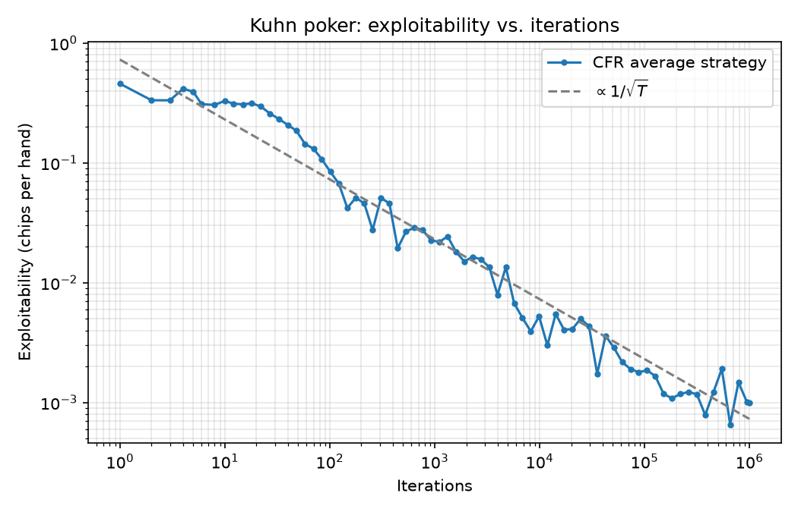

# GameTheory
# CFR for Kuhn Poker

Regret matching for rock-paper-scissors and counterfactual regret minimization (CFR)
for Kuhn poker, implemented from scratch following Neller & Lanctot (2013), with a
best-response function to measure exploitability.

## Results



Exploitability of the average strategy falls from 0.458 (uniform random play) toward 0,
at a rate close to 1/√T: the fitted slope on the log-log plot is −0.51.

After 1,000,000 iterations of chance-sampled CFR:
- Average game value for P1: −0.0568 (theory: −1/18 ≈ −0.0556)
- Exploitability: 0.0007 chips per hand

Exploitability is half the sum of what a best-responding P1 and a best-responding P2
win against the learned strategy. 

Info sets are named by the player's card followed by the betting so far
(p = pass, b = bet). For example, `2b` means "I hold a 2 and my opponent bet."

| Info set | Situation | Learned P(bet) | Kuhn's equilibrium |
|---|---|---|---|
| `1` | P1 holds 1, first move | 0.232 | α |
| `2` | P1 holds 2, first move | 0.000 | 0 |
| `3` | P1 holds 3, first move | 0.707 | 3α |
| `1pb` | P1 holds 1, passed, P2 bet | 0.000 | 0 (fold) |
| `2pb` | P1 holds 2, passed, P2 bet | 0.573 | α + 1/3 (call) |
| `3pb` | P1 holds 3, passed, P2 bet | 1.000 | 1 (call) |
| `1p` | P2 holds 1, P1 passed | 0.333 | 1/3 (bluff) |
| `2p` | P2 holds 2, P1 passed | 0.000 | 0 |
| `3p` | P2 holds 3, P1 passed | 1.000 | 1 |
| `1b` | P2 holds 1, P1 bet | 0.000 | 0 (fold) |
| `2b` | P2 holds 2, P1 bet | 0.333 | 1/3 (call) |
| `3b` | P2 holds 3, P1 bet | 1.000 | 1 (call) |

Kuhn poker has a whole family of equilibria for P1, one for each α between 0 and 1/3.
This run found α ≈ 0.23, and the other P1 rows match it: 3α ≈ 0.70 and α + 1/3 ≈ 0.57.
P2's equilibrium strategy is unique, and the learned values match it.

## How it works

Kuhn poker could be written as one payoff matrix: each player picks a complete plan
in advance (2^6 = 64 pure strategies each, so a 64×64 matrix). This is fine for Kuhn,
but the number of plans grows exponentially with the number of decisions, so it is
hopeless for larger games. CFR works on the game tree instead.

The tree is split into **information sets**: what a player knows when it is their turn,
meaning their own card plus the betting so far. A player can't tell apart the states
inside an information set (they don't see the opponent's card), so a strategy assigns
one probability distribution per information set. Kuhn poker has 12 of them.

Each iteration deals a random hand and walks the whole betting tree recursively. At
every decision it computes the value of each action and the value of the current mix.
The **counterfactual regret** of an action is how much better it would have done than the
mix, weighted by how likely chance and the opponent were to lead to this spot. These
regrets are added to a running total at the information set.

Each information set then runs **regret matching**, the same logic as in the
rock-paper-scissors trainer: the next strategy plays each action in proportion to its
positive total regret. So CFR is many small regret-matching problems, one per
information set. The CFR theorem (Zinkevich et al., 2007) shows that driving regret down
at every information set separately drives it down for the whole game.

### Why the average converges but the current strategy cycles
CFR keeps two strategies at every information set: the **current strategy**, computed
from the regrets and used to play each iteration, and the **average strategy**, a running
average of all current strategies so far. Only the average is guaranteed to converge.

The current strategies chase each other. If P1 bluffs with the 1 too often, P2's regret
pushes it toward calling with the 2. Once P2 calls more, bluffing loses money, so P1's
regret pushes it away from bluffing. Then P2 has less reason to call, so it calls less,
and bluffing becomes profitable again. The two players circle around the equilibrium
instead of settling on it, like two rock-paper-scissors players who each switch to beat
the other's last move.

Averaging cancels these swings, because they fall on both sides of the equilibrium.
Formally, regret matching guarantees that each player's average regret goes to 0 at
rate O(1/√T). In a two-player zero-sum game, if both players' average regret is at most
ε, then the average strategy profile has exploitability at most ε. The guarantee says
nothing about the current strategy, which is why the program reports the average
strategy and the plot measures the average.

## Run it

```bash
javac rps/RPSTrainer.java && java -cp rps RPSTrainer
javac kuhn/KuhnTrainer.java && java -cp kuhn KuhnTrainer
python kuhn/exploitability.py

```

## Next steps
- CFR+ and convergence comparison
- Leduc poker
- Monte Carlo CFR

## References
- T. Neller and M. Lanctot, *An Introduction to Counterfactual Regret Minimization* (2013)
- M. Zinkevich et al., *Regret Minimization in Games with Incomplete Information*, NeurIPS 2007
- H. W. Kuhn, *A Simplified Form of Poker* (1950)
